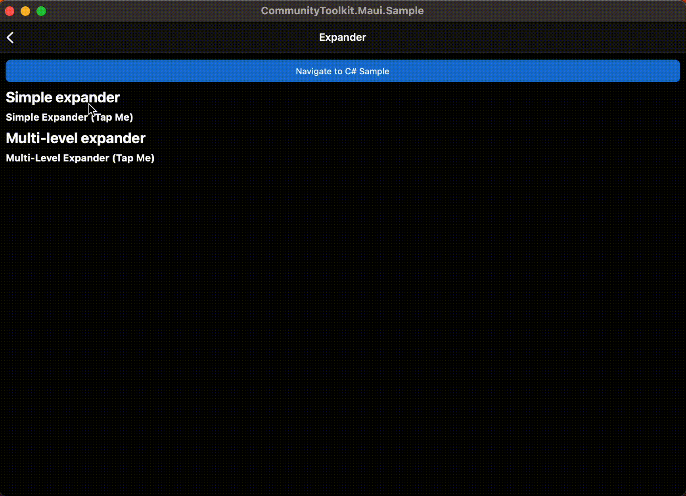

# Expander

The `Expander` control provides an expandable container to host any content. The control has two main properties to store your content:

## Header

This `Header` property can be provided with any view to allow for full customization. The `Header` will always be visible and interacting with it (clicking, tapping, or using the keyboard or a screen reader) will show/collapse the `Content`. See [Accessibility](#accessibility).

> [!NOTE]
> It is not recommended to place controls inside the header that allow user interaction. VoiceOver doesn't read a header that holds a control as one button, so that it can still reach the control.

## Content

This is the main content that will show when the `Header` property is interacted with it (clicked or tapped) or the `IsExpanded` property is modified.

> [!NOTE]
> `Expander` may work unexpectedly if it is placed inside `ListView` or `CollectionView`. However, it can be controlled with the custom implementation by setting `public Action<TappedEventArgs>? HandleHeaderTapped { get; set; }`. This action is executed each time the header is tapped. Please pay attention, by changing this action you may receive different behavior in `CollectionView` and `ListView` on all platforms.

> [!NOTE]
> The `Expander` lays out its `Header` and `Content` in a `Grid` of its own. An implicit `Style` for `Grid`, for example one in _App.xaml_, doesn't apply to that `Grid` unless the `Style` sets `ApplyToDerivedTypes`. Even then the `Background` and `BackgroundColor` of that `Grid` stay `null`, so the background of the `Expander` shows behind the `Header` and the `Content`.



## Basic usage

The following examples show how to use the `Expander` view by setting the `Header` property to be a `Label` control and the `Content` to be a `HorizontalStackLayout` with an `Image` and a `Label` inside.

### XAML

#### Including the XAML namespace

[!INCLUDE [XAML usage guidance](../includes/xaml-usage.md)]

#### Using the Expander

The following example shows how to add an `Expander` view in XAML.

```xml
<toolkit:Expander>
    <toolkit:Expander.Header>
        <Label Text="Baboon"
               FontAttributes="Bold"
               FontSize="Medium" />
    </toolkit:Expander.Header>
    <HorizontalStackLayout Padding="10">
        <Image Source="http://upload.wikimedia.org/wikipedia/commons/thumb/f/fc/Papio_anubis_%28Serengeti%2C_2009%29.jpg/200px-Papio_anubis_%28Serengeti%2C_2009%29.jpg"
               Aspect="AspectFill"
               HeightRequest="120"
               WidthRequest="120" />
        <Label Text="Baboons are African and Arabian Old World monkeys belonging to the genus Papio, part of the subfamily Cercopithecinae."
               FontAttributes="Italic" />
    </HorizontalStackLayout>
</toolkit:Expander>
```

### C#

The following example shows how to add an `Expander` view in C#.

```csharp
using CommunityToolkit.Maui.Views;

var expander = new Expander
{
    Header = new Label
    {
        Text = "Baboon",
        FontAttributes = FontAttributes.Bold,
        FontSize = Device.GetNamedSize(NamedSize.Medium, typeof(Label))
    }
};

expander.Content = new HorizontalStackLayout
{
    Padding = new Thickness(10),

    Children =
    {
        new Image
        {
            Source = "http://upload.wikimedia.org/wikipedia/commons/thumb/f/fc/Papio_anubis_%28Serengeti%2C_2009%29.jpg/200px-Papio_anubis_%28Serengeti%2C_2009%29.jpg",
            Aspect = Aspect.AspectFill,
            HeightRequest = 120,
            WidthRequest = 120
        },

        new Label
        {
            Text = "Baboons are African and Arabian Old World monkeys belonging to the genus Papio, part of the subfamily Cercopithecinae.",
            FontAttributes = FontAttributes.Italic
        }
    }
};
```

### C# Markup

```csharp
using CommunityToolkit.Maui.Views;

Content = new Expander
{
    Header = new Label()
        .Text("Baboon")
        .Font(bold: true, size: 18),

    Content = new HorizontalStackLayout
    {
        new Image()
            .Source("http://upload.wikimedia.org/wikipedia/commons/thumb/f/fc/Papio_anubis_%28Serengeti%2C_2009%29.jpg/200px-Papio_anubis_%28Serengeti%2C_2009%29.jpg")
            .Size(120)
            .Aspect(Aspect.AspectFill),

        new Label()
            .Text("Baboons are African and Arabian Old World monkeys belonging to the genus Papio, part of the subfamily Cercopithecinae.")
            .Font(italic: true)

    }.Padding(10)

}.CenterHorizontal();
```

## Accessibility

Keyboard and screen reader users can expand and collapse an `Expander` through its `Header` whenever a tap on the `Header` can: while the `Header` is visible, enabled and not input transparent. While a tap can't toggle the `Expander`, it offers no action to the keyboard or to a screen reader.

|Platform  |Behavior  |
|---------|---------|
| Windows | The `Expander` is a Tab stop. Enter toggles it when it is pressed and Space when it is released, like a `Button`. The focus visual frames only the row of the `Header`. UI Automation exposes the `Expander` as a button with the class name `Expander`, and with the `ExpandCollapse` and `Invoke` patterns. Its name comes from the `Header`: the semantic description, the text, or the texts of the views a layout `Header` holds. Its help text comes from the `SemanticProperties.Hint` of the `Header`. It raises the `ExpandCollapseState` property changed event whenever `IsExpanded` changes, also when code changes it. |
| Android | TalkBack announces the `Header` as collapsed or expanded, and lists the expand or collapse action in its actions menu. The click of a `TapGestureRecognizer` on the `Header` stays available. |
| iOS and Mac Catalyst | VoiceOver reads the whole `Header` as one button that a double tap toggles. The element has the button trait, and the header trait when the `Header` is a heading. Its label, hint and `AutomationId` come from the `Header`. VoiceOver announces it as collapsed or expanded from iOS and Mac Catalyst 18. A `Header` that holds a control, such as a `Button`, a `Switch` or an `Entry`, keeps the default accessibility elements of UIKit, and VoiceOver doesn't announce the state of the `Expander` for it. A `Header` with another `TapGestureRecognizer` lets VoiceOver tap it, so that every recognizer runs. |

Every activation from the keyboard or from assistive technology goes through the same code as a tap, so `IsExpanded`, `Command` and `CommandParameter`, `ExpandedChanged` and `HandleHeaderTapped` behave as for a tap. In a `CollectionView` on Windows, such an activation still resizes the item that holds the `Expander`.

> [!IMPORTANT]
> `HandleHeaderTapped` also runs when the `Header` is activated without a tap: from the keyboard or by UI Automation on Windows, by the expand or collapse action of TalkBack on Android, and by VoiceOver on iOS and Mac Catalyst. For these activations `TappedEventArgs.Parameter` is `null`, and `TappedEventArgs.GetPosition` returns the center of the `Header` on Windows and `null` on Android, iOS and Mac Catalyst. A custom `HandleHeaderTapped` that assumes a pointer position must handle `null`.

The `UseMauiCommunityToolkit` method registers a handler for the layout of the `Expander`, which provides this on Windows, iOS and Mac Catalyst. A handler that your app registers for `Grid` no longer applies to the `Grid` of the `Expander`. Changes to `LayoutHandler.Mapper` still apply.

### UI tests

The accessibility support changes what UI automation finds:

- **Windows:** a button with the class name `Expander`, named after the `Header`, wraps the `Header` and the `Content` in the UI Automation tree. A test that finds the `Header` by name can match this element first, and its bounds include the expanded `Content`. The element of the `Header` itself, with its `AutomationId`, is still there as a child.
- **iOS and Mac Catalyst:** the views inside a `Header` are no longer separate accessibility elements, unless the `Header` holds a control. The element of the `Header` has the `AutomationId` of the `Header`, so a query for a view inside a layout `Header` by its own `AutomationId`, for example with XCUITest or Appium, no longer finds it.

## Properties

|Property  |Type  |Description  |
|---------|---------|---------|
`Command` | `ICommand` | Executes when the `Expander` header is tapped.
`CommandParameter` | `object` | The parameter that's passed to `Command`.
`Direction` | `ExpandDirection` | Defines the expander direction.
`Content` | `IView?` | Defines the content to be displayed when the `Expander` expands.
`Header` | `IView?` | Defines the header content.
`IsExpanded` | `bool` | Determines if the `Expander` is expanded. This property uses the `TwoWay` binding mode, and has a default value of `false`.

The `ExpandDirection` enumeration defines the following members:

|Value  |Description  |
|---------|---------|
| `Down` | Indicates that the `Expander` content is under the header. |
| `Up` | Indicates that the `Expander` content is above the header. |

The `Expander` control also defines a `ExpandedChanged` event that's fired when the `Expander` header is tapped, or activated from the keyboard or by assistive technology.

### ExpandedChangedEventArgs

Event argument which contains `Expander` `IsExpanded` state.

#### Properties

|Property  |Type  |Description  |
|---------|---------|---------|
| IsExpanded | `bool` | Determines if the `Expander` is expanded. |

## Examples

You can find an example of this feature in action in the [.NET MAUI Community Toolkit Sample Application](https://github.com/CommunityToolkit/Maui/blob/main/samples/CommunityToolkit.Maui.Sample/Pages/Views/Expander/).

## API

You can find the source code for `Expander` over on the [.NET MAUI Community Toolkit GitHub repository](https://github.com/CommunityToolkit/Maui/blob/main/src/CommunityToolkit.Maui/Views/Expander).
