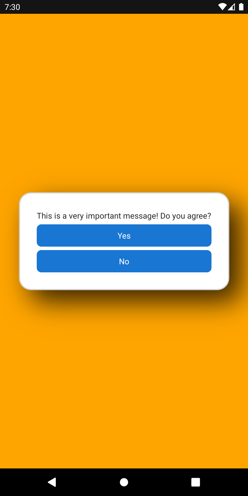
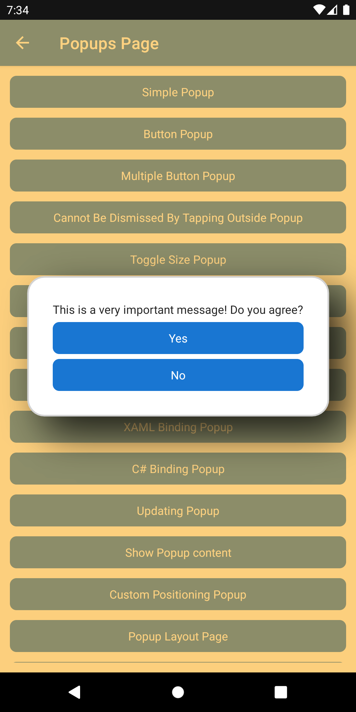
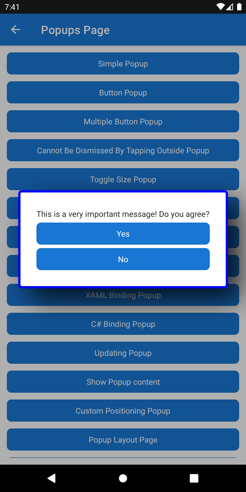
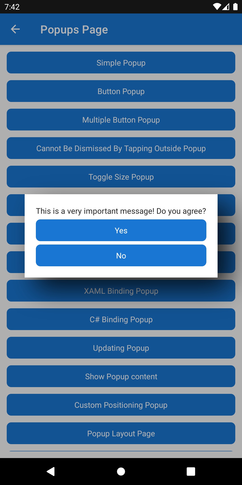
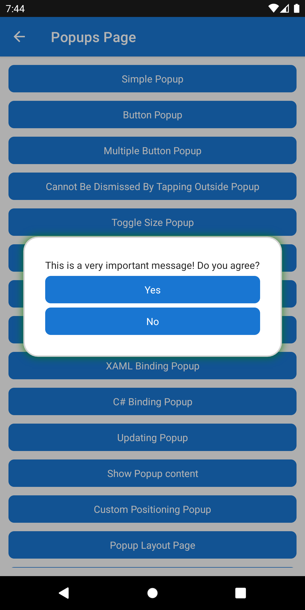

# PopupOptions - Customizing the popup behavior and appearance

The `PopupOptions` class provides the ability to customize the appearance and behavior of the `Popup`.

All of the examples in this page make use of the `SimplePopup` example that is covered at [`Popup`](../popup.md).

## Controlling whether the user can dismiss the Popup

`PopupOptions` provides settings for different dismissal behaviors:

- `CanBeDismissedByTappingOutsideOfPopup` controls whether the user can dismiss the popup by tapping outside its bounds.
- `CanBeDismissedByBackButtonPressed` controls whether the user can dismiss the popup by pressing the device back button on Android.

Both are `true` by default.

```csharp
await this.ShowPopupAsync(new SimplePopup(), new PopupOptions
{
    CanBeDismissedByTappingOutsideOfPopup = false,
    CanBeDismissedByBackButtonPressed = false
});
```

> [!NOTE]
> It is possible to cache `PopupOptions` to reuse on future navigation actions or with other popups that share the same configuration, that would prevent unnecessary allocations.

### Responding to dismissal attempts

`PopupOptions` also exposes callbacks that can be used to react when a user attempts to dismiss a popup or when the popup is actually dismissed.

- `OnTappingOutsideOfPopup` runs when the user taps outside the popup.
- `OnBackButtonPressed` runs when the user presses the back button.
- `OnDismiss` runs when the popup is dismissed.

```csharp
    await this.ShowPopupAsync(new SimplePopup(), new PopupOptions
    {
        CanBeDismissedByTappingOutsideOfPopup = true,
        CanBeDismissedByBackButtonPressed = true,
        OnTappingOutsideOfPopup = () => Console.WriteLine("Outside tap"),
        OnBackButtonPressed = () => Console.WriteLine("Back button pressed"),
        OnDismiss = () => Console.WriteLine("Popup dismissed")
    });
```

## Customize the Overlay Color

`PopupOptions` provides the `PageOverlayColor` property which can control the `Color` that overlays the current page. The following example shows how to set the `PageOverlayColor` to orange.

```csharp
await this.ShowPopupAsync(new SimplePopup(), new PopupOptions
{
    PageOverlayColor = Colors.Orange
});
```



The above `Popup` renders with an opaque background, to control the opacity modify the alpha property of a `Color`. The following example shows how to

```csharp
await this.ShowPopupAsync(new SimplePopup(), new PopupOptions
{
    PageOverlayColor = Colors.Orange.WithAlpha(0.5f)
});
```



## Customize the Popup Border

`PopupOptions` provides the `Shape` property which can control the appearance of the border around the content displayed in the `Popup`. The following example shows how to set the border to be a rounded rectangle with a corner radius of 4 and a stroke of blue.

```csharp
await this.ShowPopupAsync(new SimplePopup(), new PopupOptions
{
    Shape = new RoundRectangle
    {
        CornerRadius = new CornerRadius(4),
        Stroke = Colors.Blue,
        StrokeThickness = 4
    }
});
```



For more details on how to customize the `Shape` property see [.NET MAUI Shapes](/dotnet/maui/user-interface/controls/shapes/).

### Disable the Popup Border

In order to disable the border on a Popup, simply set the `Shape` property to `null`. The following example shows how to achieve this

```csharp
await this.ShowPopupAsync(new SimplePopup(), new PopupOptions
{
    Shape = null
});
```



## Customize the Popup Shadow

`PopupOptions` provides the `Shadow` property which can control the shadow which is applied to the `Popup`. The following example shows how to set the shadow to be green with an opacity of 80%.

```csharp
await this.ShowPopupAsync(new SimplePopup(), new PopupOptions
{
    Shadow = new Shadow
    {
        Brush = Brush.Green,
        Opacity = 0.8f
    }
});
```



For more details on how to customize the `Shadow` property see [.NET MAUI Shadow](/dotnet/maui/user-interface/shadow).

### Disable the Popup Shadow

In order to disable the border on a Popup, simply set the `Shape` property to `null`. The following example shows how to achieve this

```csharp
await this.ShowPopupAsync(new SimplePopup(), new PopupOptions
{
    Shadow = null
});
```


## Properties

|Property  |Type  |Description  |
|---------|---------|---------|
| `CanBeDismissedByTappingOutsideOfPopup` | `bool` | Gets or sets a value indicating whether the popup can be dismissed by tapping outside of the popup. |
| `CanBeDismissedByBackButtonPressed` | `bool` | Gets or sets a value indicating whether the popup can be dismissed by pressing the back button. |
| `OnTappingOutsideOfPopup` | `Action` | Gets or sets the callback executed when the user taps outside the popup. |
| `OnBackButtonPressed` | `Action` | Gets or sets the callback executed when the user presses the back button. |
| `OnDismiss` | `Action` | Gets or sets the callback executed when the popup is dismissed. |
| `PageOverlayColor` | `Color` | Gets or sets the `Color` of the overlay behind the `Popup`. |
| `Shape` | `Shape` | Gets or sets the border shape for the `Popup`. Set this to `null` to remove any border styling. |
| `Shadow` | `Shadow` | Gets or sets the `Shadow` of the `Popup`. Set this to `null` to remove any shadow. |

## Examples

You can find an example of this feature in action in the [.NET MAUI Community Toolkit Sample Application](https://github.com/CommunityToolkit/Maui/blob/main/samples/CommunityToolkit.Maui.Sample/Views/Popups/ReturnResultPopup.xaml).

## API

You can find the source code for `PopupOptions` over on the [.NET MAUI Community Toolkit GitHub repository](https://github.com/CommunityToolkit/Maui/tree/main/src/CommunityToolkit.Maui/Views/Popup).

## Additional Resources

- [`Popup`](../popup.md)
- [`IPopupService`](../popup-service.md)
- [`Popup` - Returning a result](./popup-result.md)
- [`Popup` - Combining Popup features to provide a comprehensive example](./popup-complex.md)
